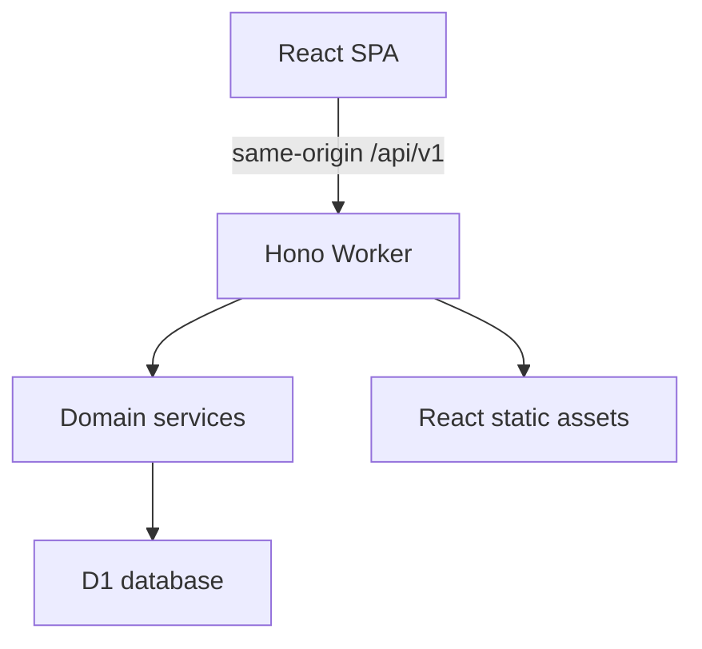

# Stacklet — Investment Journal

เอกสารข้อกำหนดและแนวทางพัฒนาเว็บบันทึกเงินต้นลงทุนด้วย **Hono + React + Cloudflare Workers + D1**

## 1. เป้าหมาย

เว็บส่วนตัวสำหรับจดรายการซื้อหุ้น กองทุน และ Bitcoin โดยเน้นตอบคำถาม:

- ลงทุนไปแล้วเท่าไร แยกตามสินทรัพย์?
- มีเงินสดพร้อมลงทุนเหลือเท่าไร?
- เงินต้นลงทุนรวมเงินสดเป็นเท่าไร?
- สะสม BTC แล้วกี่เหรียญ และใกล้เป้าหมายแค่ไหน?

ไม่ต้องดึงราคาตลาด ไม่คำนวณผลตอบแทน และไม่เชื่อมต่อโบรกเกอร์หรือ exchange ใน MVP

**หลักสำคัญ: เงินสดเป็นยอดบัญชีส่วนกลาง แยกจากรายการซื้อ ผู้ใช้ปรับเพิ่ม ลด หรือกำหนดยอดคงเหลือได้โดยตรง**

## 2. ขอบเขต MVP

### 2.1 Dashboard

แสดง:

- เงินต้นรวม = ต้นทุนซื้อสินทรัพย์ทั้งหมด + เงินสดคงเหลือทุกบัญชี
- ต้นทุนลงทุน แยกหุ้น กองทุน และ BTC
- เงินสดรวม และยอดคงเหลือแยกบัญชี
- ยอดซื้อเดือนนี้ และจำนวนรายการซื้อ
- สัดส่วนต้นทุนลงทุนและเงินสด
- จำนวน BTC สะสม เป้าหมาย BTC เปอร์เซ็นต์สำเร็จ และจำนวนที่ยังขาด

เงินต้นรวมในเอกสารนี้หมายถึง **ต้นทุนสินทรัพย์ที่บันทึก + เงินสดคงเหลือปัจจุบัน** ไม่ใช่ยอดฝากสะสมตลอดอายุบัญชี และไม่ใช่มูลค่าตลาด หากลดเงินสดออก เงินต้นรวมจะลดตาม

### 2.2 บัญชีเงินสด

- สร้างหลายบัญชีได้ เช่น เงินสด Dime, เงินสดธนาคาร, เงินสดสำหรับ BTC
- ระบุชื่อบัญชีและยอดเริ่มต้น
- ปรับยอดได้ 3 วิธี: เพิ่มเงินสด, ลดเงินสด, กำหนดยอดคงเหลือใหม่
- เงินสดต่ำสุด 0 บาท ห้ามติดลบ
- การปรับเงินสดไม่สร้างรายการในหน้ารายการซื้อ
- แก้ชื่อบัญชีได้
- เก็บประวัติการเปลี่ยนยอดภายในระบบเพื่อสอบทาน แม้ไม่แสดงเป็น transaction ให้ผู้ใช้
- ไม่ลบบัญชีที่มีการอ้างอิงจากรายการซื้อ ใช้ archive แทนได้ในอนาคต

MVP ใช้เงินบาททุกบัญชี ชื่อบัญชีที่เกี่ยวกับ USD หรือ USDT ไม่ได้ทำให้บัญชีนั้นรองรับหลายสกุลเงิน ผู้ใช้กรอกยอดเงินบาทที่ต้องการติดตามเอง

### 2.3 รายการซื้อ

ข้อมูลที่ต้องกรอก:

| ฟิลด์                              | หุ้น / กองทุน                  | Bitcoin     |
| -------------------------------- | --------------------------- | ----------- |
| วันที่ซื้อ                            | จำเป็น                       | จำเป็น       |
| ประเภท                           | `stock` / `fund`            | `btc`       |
| ชื่อหรือสัญลักษณ์สินทรัพย์                | จำเป็น                       | ค่าเริ่มต้น BTC |
| เงินต้นที่จ่ายจริงเป็นบาท รวมค่าธรรมเนียม | จำเป็น                       | จำเป็น       |
| จำนวน BTC ที่ได้รับจริง               | ไม่ใช้                        | จำเป็น       |
| แหล่งเงิน                          | บัญชีเงินสด หรือเงินใหม่จากภายนอก | เช่นเดียวกัน   |
| หมายเหตุ                          | ไม่บังคับ                      | ไม่บังคับ      |

- เพิ่ม แก้ไข และลบรายการซื้อได้
- กรองตามประเภท ค้นหาตามชื่อ และเรียงวันที่ล่าสุด
- หากมีบัญชีเงินสด ให้เลือกบัญชีล่าสุดที่ใช้และยัง active เป็นค่าเริ่มต้น ถ้าไม่มีให้เลือกเงินใหม่จากภายนอก
- ไม่ให้เลือกเงินสดเป็นประเภท transaction อีกต่อไป
- สำหรับหุ้นและกองทุน ยังไม่ต้องบันทึกจำนวนหุ้นหรือหน่วยลงทุน

### 2.4 เป้าหมาย BTC

- ตั้งหรือแก้ไขเป้าหมายเป็นจำนวน BTC มากกว่า 0
- มีเป้าหมายที่ active เพียงหนึ่งค่า
- ล้างเป้าหมายได้ โดยไม่กระทบรายการซื้อ
- จำนวน BTC มาจากผลรวมจำนวนที่ได้รับจริงในรายการประเภท BTC
- เปอร์เซ็นต์แสดงเกิน 100% ได้ แต่แถบ progress กว้างสูงสุด 100%

### 2.5 สำรองและกู้คืนข้อมูล

- Export JSON รวมบัญชีเงินสด รายการซื้อ เป้าหมาย และ schema version
- Import แบบ replace พร้อม preview จำนวนรายการและบัญชีก่อนยืนยัน
- ก่อน replace ต้องให้ดาวน์โหลด backup หรือสร้าง backup ที่กู้คืนได้
- ข้อมูลเก็บใน D1 และใช้งานข้ามอุปกรณ์ได้เมื่อเข้าสู่ระบบเจ้าของเดียวกัน

## 3. User flow

### 3.1 เริ่มใช้งาน

1. เข้าสู่แอปส่วนตัว
2. เพิ่มบัญชีเงินสดและยอดคงเหลือ เช่น 50,000 บาท
3. ตั้งเป้าหมาย BTC หากต้องการ
4. เริ่มบันทึกรายการซื้อ

### 3.2 ซื้อด้วยเงินสดในแอป

1. กดเพิ่มรายการ
2. เลือกหุ้น กองทุน หรือ BTC
3. กรอกวันที่ สินทรัพย์ และยอดเงินบาทที่จ่ายจริง
4. ถ้าเป็น BTC ให้กรอกจำนวน BTC ที่ได้รับ
5. เลือกบัญชีเงินสดต้นทาง
6. ฟอร์มแสดงยอดใช้ได้และยอดคงเหลือหลังซื้อก่อนกดบันทึก
7. Backend บันทึกรายการและหักเงินสดสำเร็จพร้อมกัน
8. Dashboard และยอดบัญชีอัปเดต

| รายการ   |  ก่อนซื้อ | หลังซื้อ BTC 10,000 บาท |
| -------- | -----: | -------------------: |
| เงินสด    | 50,000 |               40,000 |
| ต้นทุน BTC |      0 |               10,000 |
| เงินต้นรวม | 50,000 |               50,000 |

### 3.3 ซื้อด้วยเงินใหม่จากภายนอก

ใช้เมื่อผู้ใช้จ่ายจากเงินที่ยังไม่อยู่ในบัญชีเงินสดของแอป

- สร้างรายการซื้อโดย `cashAccountId = null`
- ไม่หักบัญชีเงินสด
- เงินต้นรวมเพิ่มตามต้นทุนรายการซื้อ
- หากผู้ใช้เพิ่มเงินก้อนนั้นไว้ในบัญชีเงินสดแล้ว ต้องเลือกบัญชีนั้น เพื่อไม่ให้นับซ้ำ

### 3.4 ปรับเงินสด

กดปรับยอดที่การ์ดบัญชี เลือกเพิ่ม / ลด / กำหนดยอด แล้วบันทึกได้ทันที ไม่ต้องสร้างหรือแก้ไข transaction

- เพิ่ม 5,000 บาท → ยอดเงินสดและเงินต้นรวมเพิ่ม 5,000 บาท
- ลด 2,000 บาท → ยอดเงินสดและเงินต้นรวมลด 2,000 บาท
- กำหนดยอดใหม่ → ใช้แทนยอดคงเหลือที่ระบบแสดง หลังตรวจสอบกับยอดจริง

การปรับยอดเป็นการแก้ค่าคงเหลือ ณ ปัจจุบัน ไม่แก้ย้อนหลัง ไม่เปลี่ยนต้นทุนหรือจำนวน BTC ของรายการซื้อเดิม

### 3.5 แก้ไขหรือลบรายการซื้อ

- แก้ไข: คืนยอดเดิมให้บัญชีต้นทางก่อน แล้วหักยอดใหม่จากแหล่งเงินใหม่
- บัญชีเดิม: ยอดใช้ได้ = เงินสดปัจจุบัน + เงินที่คืนจากรายการเดิม
- เปลี่ยนบัญชี: คืนบัญชีเดิม แล้วหักบัญชีใหม่
- เปลี่ยนเป็นเงินใหม่จากภายนอก: คืนบัญชีเดิม และไม่หักบัญชีอื่น
- เปลี่ยนจากเงินภายนอกเป็นเงินสด: หักบัญชีที่เลือก
- ลบ: คืนต้นทุนรายการให้บัญชีเดิมเฉพาะรายการที่ใช้เงินสด
- ลบรายการที่ใช้เงินภายนอก: ไม่คืนเงินเข้าเงินสด
- ถ้าขั้นตอนไหนผิดพลาด ต้องไม่เปลี่ยนข้อมูลใดเลย

หากเคยปรับยอดเงินสดเองหลังซื้อ การแก้ไขหรือลบรายการเดิมยังต้องคืนเงินตามกติกานี้ ผู้ใช้อาจต้องปรับยอดให้ตรงกับยอดจริงอีกครั้ง ให้แจ้งผลการคืนเงินอย่างชัดเจน

## 4. สิ่งที่ยังไม่ทำ

- ขายสินทรัพย์ ถอน BTC หรือโอนระหว่างกระเป๋า
- กำไรขาดทุน ราคาตลาด และการ sync ราคา
- ต้นทุนเฉลี่ยแบบ FIFO / moving average และภาษี
- หลายสกุลเงินและอัตราแลกเปลี่ยนอัตโนมัติ
- โอนเงินสดระหว่างบัญชีในคำสั่งเดียว
- หลาย portfolio, ผู้ใช้ทั่วไปสมัครสมาชิก หรือแชร์บัญชีกับผู้อื่น
- แจ้งเตือนหรือ recurring DCA อัตโนมัติ

## 5. Technology และสถาปัตยกรรม

| ส่วน            | ตัวเลือก                                                   |
| -------------- | -------------------------------------------------------- |
| Frontend       | React + TypeScript + Vite                                |
| API            | Hono + `@hono/zod-openapi` บน Cloudflare Workers         |
| Hosting        | Worker เดียวเสิร์ฟ API และ React static assets              |
| Database       | Cloudflare D1                                            |
| DB access      | D1 prepared statements + SQL schema                      |
| Validation     | Zod แชร์ request/response schemas ระหว่าง frontend/backend |
| Server state   | TanStack Query                                           |
| UI             | shadcn/ui + Tailwind CSS                                 |
| Authentication | Cloudflare Access สำหรับเจ้าของคนเดียว                      |
| Testing        | Vitest และ Workers/D1 integration tests                  |
| Deploy         | Wrangler + Cloudflare Vite plugin                        |

เลือก SQL โดยตรงใน MVP เพื่อควบคุม atomic writes, triggers และ D1 batch ได้ชัดเจน หากเพิ่ม Drizzle ภายหลัง ให้เก็บ raw SQL definitions สำหรับ triggers ไว้



- ไม่ต้องแยก deploy frontend/backend และไม่ต้องเปิด CORS ข้าม origin
- ให้ `/api/*` เข้า Worker เสมอ รวม route ที่ไม่มีอยู่จริงต้องได้ JSON 404 ไม่ใช่ SPA HTML
- หน้า frontend ใช้ SPA fallback
- D1 เป็น source of truth; localStorage ใช้ได้เฉพาะ UI preference ไม่ใช่เก็บยอดเงินจริงหลัก
- อ่าน summary หลายส่วนจาก snapshot เดียว เช่น batch reads เพื่อไม่ให้ยอดการ์ดและตารางมาจากคนละจังหวะ
- MVP ไม่เปิด read replication; หากเปิดภายหลัง ต้องใช้ Sessions/bookmarks เพื่อรักษา read-after-write

### API documentation และ frontend client

- ประกาศ API ด้วย `createRoute` และ `OpenAPIHono` จาก `@hono/zod-openapi` โดยใช้ Zod contracts ร่วมกัน
- สร้าง OpenAPI 3.1 ที่ `/api/v1/openapi.json` และแสดง Scalar ด้วย `@scalar/hono-api-reference` ที่ `/api/v1/reference` ทั้งสองเส้นทางต้องผ่าน auth เดียวกับ API
- Frontend ใช้ `hc<AppType>` จาก `hono/client` และ import server type แบบ type-only โดยรักษา runtime response validation, idempotency keys และ dataset epoch checks

### UI components

ใช้ **shadcn/ui** เป็นชุด UI หลักร่วมกับ Tailwind CSS และปรับ theme ให้เข้ากับแอป โดยใช้ Button, Card, Input, Select, Dialog, Alert Dialog, Table, Badge และ Progress ตามความเหมาะสม ฟอร์มซื้อและปรับเงินสดใช้ Dialog ส่วนยืนยันการลบใช้ Alert Dialog

## 6. โครงสร้างโปรเจค

ใช้ repository และ package เดียว แยก web, server และ shared ตามหน้าที่ ไม่ต้องใช้ monorepo หลายแอป

| Path                             | หน้าที่                                                       |
| -------------------------------- | ---------------------------------------------------------- |
| `src/web/main.tsx`               | React entry                                                |
| `src/web/app.tsx`                | App shell และ routes                                       |
| `src/web/features/dashboard/`    | การ์ดสรุปและสัดส่วน                                            |
| `src/web/features/cash/`         | บัญชีเงินสดและฟอร์มปรับยอด                                      |
| `src/web/features/transactions/` | รายการซื้อและฟอร์มซื้อ                                          |
| `src/web/features/btc-goal/`     | เป้าหมาย BTC                                                |
| `src/web/features/backup/`       | Import/export                                              |
| `src/web/components/ui/`         | shadcn/ui components                                       |
| `src/web/components/`            | UI ที่ใช้ร่วมกันและประกอบจาก shadcn/ui                          |
| `src/web/lib/api.ts`             | Typed API client                                           |
| `src/web/lib/query-keys.ts`      | TanStack Query keys                                        |
| `src/server/index.ts`            | Hono entry และ middleware                                  |
| `src/server/routes/`             | HTTP routes                                                |
| `src/server/services/`           | กติกาธุรกิจและ orchestration                                  |
| `src/server/repositories/`       | D1 statements                                              |
| `src/server/middleware/`         | Auth, errors, request ID                                   |
| `src/shared/contracts/`          | Zod schemas และ API types                                  |
| `src/shared/money.ts`            | Parse/format บาทและสตางค์                                   |
| `src/shared/btc.ts`              | Parse/format BTC และ satoshis                              |
| `db/schema.sql`                  | สร้างตาราง indexes constraints และ triggers สำหรับฐานข้อมูลใหม่ |
| `tests/domain/`                  | สูตรคำนวณและ validation                                     |
| `tests/integration/`             | D1 atomicity, concurrency และ API                          |
| `tests/e2e/`                     | Flow สำคัญผ่าน UI                                            |
| `wrangler.jsonc`                 | Worker, assets และ D1 binding                              |
| `vite.config.ts`                 | React + Cloudflare plugin                                  |
| `worker-configuration.d.ts`      | สร้างผ่าน Wrangler types                                     |

## 7. Data model

ทุกตารางใช้ ID แบบ UUID และ timestamps เป็น UTC ISO 8601 ส่วนวันซื้อเก็บ `YYYY-MM-DD` ตามวันในประเทศไทย

### 7.1 `cash_accounts`

| Column           | Type    | กติกา                         |
| ---------------- | ------- | ---------------------------- |
| `id`             | TEXT PK | UUID                         |
| `name`           | TEXT    | ชื่อบัญชี 1–80 ตัวอักษร            |
| `currency`       | TEXT    | MVP ต้องเป็น THB               |
| `balance_satang` | INTEGER | >= 0                         |
| `version`        | INTEGER | เริ่ม 1 เพิ่มทุกครั้งที่เปลี่ยนยอดหรือชื่อ |
| `created_at`     | TEXT    | UTC                          |
| `updated_at`     | TEXT    | UTC                          |

### 7.2 `transactions`

มีเฉพาะรายการซื้อ ไม่เก็บเงินสดเป็น transaction

| Column            | Type         | กติกา                                 |
| ----------------- | ------------ | ------------------------------------ |
| `id`              | TEXT PK      | UUID                                 |
| `asset_type`      | TEXT         | stock / fund / btc                   |
| `asset_name`      | TEXT         | 1–80 ตัวอักษร                          |
| `trade_date`      | TEXT         | YYYY-MM-DD                           |
| `amount_satang`   | INTEGER      | > 0 รวมค่าธรรมเนียมแล้ว                 |
| `btc_satoshis`    | INTEGER NULL | btc ต้อง > 0; ประเภทอื่นต้อง NULL        |
| `cash_account_id` | TEXT NULL FK | NULL = เงินภายนอก; FK delete RESTRICT |
| `note`            | TEXT NULL    | ไม่เกิน 500 ตัวอักษร                     |
| `version`         | INTEGER      | optimistic concurrency               |
| `created_at`      | TEXT         | UTC                                  |
| `updated_at`      | TEXT         | UTC                                  |

Indexes: `(trade_date DESC, id DESC)`, `(asset_type, trade_date DESC, id DESC)`, `(cash_account_id)`

### 7.3 `btc_goal`

แถวเดียว `id = 1`: `target_satoshis INTEGER NULL`, `version`, `updated_at`

`target_satoshis` เป็น NULL เมื่อยังไม่ตั้งเป้าหมาย มิฉะนั้นต้อง > 0

### 7.4 `cash_balance_events` — internal audit

ไม่แสดงในตารางรายการซื้อของผู้ใช้

ฟิลด์: `id`, `cash_account_id`, `kind`, `delta_satang`, `balance_after_satang`, `transaction_id`, `operation_id`, `created_at`

- `kind`: opening / manual_add / manual_subtract / manual_set / purchase_debit / purchase_refund
- `transaction_id` เป็น reference สำหรับ audit ไม่ใช้ FK ที่ทำให้ลบรายการซื้อไม่ได้
- เก็บ audit ต่อหลังลบ transaction เพื่ออธิบายการคืนเงินได้
- Import snapshot ต้องสร้าง audit baseline ใหม่ และต้องไม่ replay audit เดิมจนยอดเปลี่ยนซ้ำ

### 7.5 `mutation_requests` — ป้องกันการบันทึกซ้ำ

ฟิลด์: `idempotency_key` PK, `method`, `route`, `request_hash`, `response_status`, `response_json`, `created_at`

ใช้กับ mutation ทั้งการซื้อและการปรับเงินสด การตรวจ key และการแก้ข้อมูลต้องอยู่ใน atomic write เดียวกัน ไม่ใช่เช็กก่อนนอก transaction แล้วค่อยเขียน

## 8. ความแม่นยำของตัวเลข

- เงินเก็บเป็นสตางค์ integer: 10,000.25 บาท = 1,000,025 สตางค์
- BTC เก็บเป็น satoshis integer: 0.003 BTC = 300,000 satoshis
- ห้ามใช้ floating point บวก/ลบยอดคงเหลือหรือรวม BTC
- API รับ/ส่งยอดเป็น decimal string หรือ integer string ตามตัวอย่างด้านล่าง
- Parse string ด้วยการแยกจำนวนเต็มและทศนิยม ไม่ใช้ `parseFloat(value) * 100`
- บาทรองรับไม่เกิน 2 ตำแหน่ง; BTC ไม่เกิน 8 ตำแหน่ง ห้ามปัดส่วนเกินแบบเงียบ ๆ
- กำหนดเพดานเงินต่อบัญชีและรายการ 1,000,000,000 บาท และตรวจ aggregate ให้อยู่ใน safe integer
- จำกัดจำนวน BTC/เป้าหมายสูงสุด 21,000,000 BTC เพื่อให้ satoshis อยู่ใน safe integer ของ JavaScript
- Summary ใช้ integer cents/satoshis ก่อน format เป็น string ที่ API boundary

## 9. Atomicity และ concurrency บน D1

**ห้ามแยกคำสั่งสร้าง transaction กับหักเงินสดเป็นคนละ network call ที่ commit แยกกัน**

แนวทางหลัก: ให้ SQLite triggers ดูแลผลกระทบเงินสดจากการ INSERT / UPDATE / DELETE รายการซื้อ ส่วน service ใช้ D1 `batch()` เมื่อมี idempotency และ audit หลายคำสั่ง

กติกา triggers:

1. INSERT รายการซื้อที่มีบัญชี → หักเงินสดและเพิ่ม version บัญชี
2. UPDATE → คืนยอด OLD ให้บัญชี OLD ก่อน แล้วหักยอด NEW จากบัญชี NEW
3. DELETE → คืนยอด OLD ให้บัญชี OLD
4. ทุกการเปลี่ยนยอดต้องสร้าง internal audit ใน atomic operation เดียวกัน
5. Constraint `balance_satang >= 0` ต้องทำให้ทั้ง statement/batch ล้มเหลวเมื่อเงินไม่พอ
6. ใช้ foreign keys และ CHECK constraints ป้องกันยอดติดลบ ประเภทไม่ถูกต้อง และ BTC จำนวนไม่ถูกต้อง
7. ให้ SQL schema กำหนดลำดับการคืนและหักภายใน trigger body เดียว อย่าอาศัยลำดับการทำงานของหลาย triggers ที่ SQLite ไม่รับประกัน
8. ห้าม service หักเงินซ้ำ หาก trigger เป็นผู้หักอยู่แล้ว

D1 batch rollback เมื่อมี statement ล้มเหลว แต่ UPDATE ที่ match 0 rows ไม่ใช่ SQL error โดยอัตโนมัติ ดังนั้นต้องจัดการ optimistic conflict ให้ถูกต้อง:

- UPDATE/DELETE รายการซื้อใช้ `WHERE id = ? AND version = ?`
- ถ้า 0 rows ให้ตอบ 409 หรือ 404 ตามกรณี และต้องไม่ commit idempotency success ที่หลอกว่าแก้สำเร็จ
- กรณีหลาย statements ที่ต้องพึ่งผล CAS ให้มี SQL guard ที่ทำให้ batch fail จริงเมื่อ version ไม่ตรง ไม่ตรวจหลัง batch commit แล้วค่อยพยายาม rollback
- การปรับเงินสดใช้ version ของบัญชี ป้องกันฟอร์มเก่าทับยอดที่เพิ่งถูกหักจากการซื้อ
- สร้างและทดสอบ SQL guard/triggers กับ D1 runtime จริงก่อนถือว่าพร้อมใช้
- ห้ามสมมติว่า D1 รองรับ interactive transaction callback แบบ PostgreSQL ORM

สำหรับการกดซ้ำ/timeout:

- Frontend สร้าง idempotency key หนึ่งครั้งต่อการ submit และใช้ key เดิมเมื่อ retry
- key เดิม + payload เดิม → ส่งผลลัพธ์เดิม ไม่หักเงินซ้ำ
- key เดิม + payload ต่างกัน → 409 IDEMPOTENCY_CONFLICT
- ห้ามเรียก external service ระหว่างชุด mutation

## 10. API contract

Base path: `/api/v1` ทุก endpoint ต้องผ่าน auth

| Method | Endpoint                                           | หน้าที่                                 |
| ------ | -------------------------------------------------- | ------------------------------------ |
| GET    | `/summary?month=2026-11`                           | Summary, cash, allocations, BTC goal |
| GET    | `/cash-accounts`                                   | รายการบัญชีเงินสด                       |
| POST   | `/cash-accounts`                                   | สร้างบัญชีพร้อมยอดตั้งต้น                   |
| PATCH  | `/cash-accounts/:id`                               | แก้ชื่อ พร้อม expectedVersion            |
| POST   | `/cash-accounts/:id/adjustments`                   | เพิ่ม ลด หรือ set ยอดโดยตรง             |
| GET    | `/transactions?type=btc&q=BTC&cursor=...&limit=30` | รายการซื้อแบบ cursor pagination        |
| POST   | `/transactions`                                    | สร้างรายการและหักเงินสด                 |
| PATCH  | `/transactions/:id`                                | แก้ไข คืนยอดเดิมและหักยอดใหม่             |
| DELETE | `/transactions/:id`                                | ลบและคืนเงินสด พร้อม expectedVersion    |
| GET    | `/btc-goal`                                        | อ่านเป้าหมาย                           |
| PUT    | `/btc-goal`                                        | ตั้ง/แก้/ล้างเป้าหมาย                     |
| GET    | `/backup`                                          | Export snapshot                      |
| POST   | `/imports/validate`                                | ตรวจไฟล์และ preview โดยไม่แก้ข้อมูล       |
| POST   | `/imports/replace`                                 | ยืนยัน replace จากไฟล์ที่ผ่าน validation   |

ใช้ `Idempotency-Key` header ทุก mutation รวม import replace; DELETE ส่ง version ผ่าน `If-Match` เช่น `"3"` ส่วน PATCH/adjustments ส่ง `expectedVersion` ใน body

### ตัวอย่างสร้างรายการซื้อ

```json
{
  "assetType": "btc",
  "assetName": "BTC",
  "tradeDate": "2026-11-11",
  "amountThb": "10000.00",
  "btcQuantity": "0.00300000",
  "cashAccountId": "uuid-of-cash-account",
  "note": "DCA"
}
```

`cashAccountId: null` = เงินใหม่จากภายนอก สำหรับหุ้นและกองทุนส่ง `btcQuantity: null`

### ตัวอย่างปรับเงินสด

```json
{
  "mode": "add",
  "amountThb": "5000.00",
  "expectedVersion": 4
}
```

`mode`: add / subtract / set; amount >= 0, set 0 ได้; add/subtract ควรมากกว่า 0

### ตัวอย่าง response หลังซื้อ

```json
{
  "data": {
    "transaction": { "id": "transaction-uuid", "version": 1 },
    "affectedCashAccounts": [
      { "id": "uuid-of-cash-account", "balanceThb": "40000.00", "version": 5 }
    ]
  }
}
```

### Error format

```json
{
  "error": {
    "code": "INSUFFICIENT_CASH",
    "message": "เงินสดไม่พอ กรุณาลดยอดซื้อหรือเติมเงินก่อน",
    "requestId": "request-uuid"
  }
}
```

| HTTP    | ตัวอย่าง code                                               |
| ------- | --------------------------------------------------------- |
| 400     | VALIDATION_ERROR, INVALID_BACKUP                          |
| 401/403 | UNAUTHORIZED, FORBIDDEN                                   |
| 404     | TRANSACTION_NOT_FOUND, CASH_ACCOUNT_NOT_FOUND             |
| 409     | INSUFFICIENT_CASH, VERSION_CONFLICT, IDEMPOTENCY_CONFLICT |
| 413     | IMPORT_TOO_LARGE                                          |
| 500     | INTERNAL_ERROR โดยไม่ส่ง SQL หรือ stack trace                |

## 11. Validation และ frontend behavior

- ตรวจวันจริงในปฏิทิน ไม่รับวันที่อย่าง 2026-02-31
- ยอดซื้อ > 0; เงินสดคงเหลือ >= 0
- ตรวจชื่อหลัง trim และจำกัดความยาวทุก string
- BTC quantity > 0 เฉพาะประเภท BTC; ประเภทอื่นต้อง NULL
- บัญชีต้นทางต้องมีอยู่จริง
- แสดงยอดเงินหลังซื้อในฟอร์ม และตรวจเงินไม่พอทั้ง frontend/backend
- เมื่อ edit ให้รวมเงินที่จะคืนจากรายการเดิมในยอดใช้ได้ของบัญชีเดิม
- ปิดปุ่ม submit ขณะบันทึก และคงข้อมูลฟอร์มเมื่อบันทึกล้มเหลว
- ไม่ทำ optimistic balance update ฝั่ง UI ใน MVP; รอ server สำเร็จแล้ว invalidate queries
- หลัง mutation สำเร็จ refresh summary, cash accounts, transactions และ goal summary ที่เกี่ยวข้อง
- หาก version conflict ให้ refetch และแจ้งว่ามีข้อมูลใหม่ ไม่เขียนทับเงียบ ๆ
- รองรับมือถือ; ตารางเลื่อนแนวนอนได้ และการ์ดเงินสดวางเป็นคอลัมน์เดียวบนจอเล็ก
- วันรายงานใช้ Asia/Bangkok; UTC timestamps ไม่ใช้แทน trade date
- ค้นหาแบบ case-insensitive ชื่อสินทรัพย์ MVP ใช้ LIKE พร้อม escape wildcard; ไม่จำเป็นต้องทำ full-text search

## 12. Authentication และการป้องกันข้อมูล

MVP เป็นแอปส่วนตัวเจ้าของเดียว ใช้ Cloudflare Access allowlist อีเมลเจ้าของ และตรวจ JWT ใน Worker ด้วย issuer, audience, signature และ expiry ตามเอกสาร Cloudflare

- ห้ามเชื่ออีเมลจาก header ที่ผู้เรียกสามารถปลอมได้โดยไม่ตรวจ token
- ตรวจ allowlist หลังยืนยัน token
- ต้องป้องกัน API รวม workers.dev, preview และ route อื่นที่เข้าถึง Worker ได้ ไม่เปิดทางลัด bypass auth
- Same-origin requests; ตรวจ Origin สำหรับ mutation และออกแบบ CSRF protection ให้สอดคล้องกับ cookie-based Access session
- Responses ทางการเงินใช้ Cache-Control: no-store
- D1 binding ใช้ชื่อ DB; secrets และ Access config อยู่ใน Cloudflare settings ไม่ใส่ credential ใน frontend
- Log เฉพาะ request ID, error code และ duration ไม่ log payload การเงินทั้งก้อนหรือ backup
- Development auth bypass อนุญาตเฉพาะ local development และต้องปิดเด็ดขาดใน production

หากขยายเป็น multi-user SaaS ภายหลัง ให้เพิ่ม user ownership ทุกตารางและตรวจ authorization ทุก query ก่อนเปิดให้คนอื่นสมัคร ใช้ schema นี้แบบแชร์ข้อมูลหลายคนโดยไม่มี ownership ไม่ได้

## 13. การเริ่มต้นและไฟล์สำรอง

โปรเจคเริ่มจากฐานข้อมูลใหม่ ผู้ใช้เพิ่มบัญชีเงินสดและรายการซื้อผ่านแอป

- Backup ใช้ `schemaVersion: 1` และ `exportedAt` เก็บเงินและ BTC เป็น decimal strings
- Import รองรับเฉพาะไฟล์สำรองรูปแบบของโปรเจคนี้
- ตรวจ schema, references, จำนวนรายการ และผลรวมก่อนยืนยัน replace
- โหลด snapshot แบบ atomic โดยไม่ replay การหักเงินจากรายการซื้อ เพราะยอดเงินสดในไฟล์เป็นยอดคงเหลือหลังหักแล้ว
- ใช้ dedicated restore path ที่จัดการ purchase triggers ให้ถูกต้อง โดยไม่ปิด validation ทั่วระบบ
- สร้าง audit baseline จากยอดที่กู้คืน ไม่ replay audit จนยอดเปลี่ยนซ้ำ
- หลัง restore ตรวจเงินต้นรวม จำนวน BTC และเป้าหมายให้ตรงกับ preview
- จำกัดไฟล์ไม่เกิน 1 MiB และ transaction ไม่เกิน 1,000 รายการ รวมทั้งต้องผ่านเพดาน serialized batch และ SQL constraints ของ D1 ก่อนเขียน
- หากเกิน limit ให้ปฏิเสธก่อน mutation ห้ามทยอยลบหรือเขียน production แล้วค่อยพบปัญหา

## 14. การทดสอบที่ต้องมี

### Domain และ API

- มีเงินสด 50,000 ซื้อ BTC 10,000 → เหลือ 40,000 เงินต้นรวมเท่าเดิม
- ซื้อจากเงินภายนอก → เงินสดไม่เปลี่ยน เงินต้นรวมเพิ่ม
- ใช้เงินสดหมดพอดี → ยอด 0 สำเร็จ
- เงินไม่พอ → ไม่สร้าง transaction ไม่เปลี่ยนเงินสด
- แก้ยอดซื้อเพิ่ม/ลด → คืนเดิมและหักใหม่ถูกต้อง
- เปลี่ยนบัญชีต้นทาง และสลับเงินสด ↔ เงินภายนอก
- ลบรายการ → คืนเงินครั้งเดียว
- ปรับเงินสดโดยตรง → ไม่สร้างรายการซื้อ
- ตั้งเงินสดเป็น 0 ได้ ลดจนติดลบไม่ได้
- ผลรวม BTC และความคืบหน้าเป้าหมายแม่นยำ
- เป้าหมายว่าง / 100% / เกิน 100%

### D1 integration และ concurrency

- สองรายการซื้อพร้อมกันซึ่งรวมกันเกินเงินสด → สำเร็จได้เท่าที่เงินพอ ยอดไม่ติดลบ
- Retry idempotency key เดิม → ไม่มี debit ซ้ำ
- แก้ไขและลบพร้อมกันด้วย version เดียว → สำเร็จเพียงคำสั่งเดียว
- การปรับเงินสดชนกับซื้อ → ใช้ version/atomic rules ป้องกัน lost update
- จำลอง failure ใน audit/idempotency → rollback transaction และยอดเงินสดทั้งหมด
- UPDATE 0 rows ต้องไม่ commit success response ของ mutation ที่ไม่ได้เกิดขึ้น
- Restore จากไฟล์สำรองไม่ replay การหักเงินเดิม
- ทดสอบ constraints/triggers กับ D1 local runtime และ staging D1 ไม่ทดสอบแค่ array ใน memory

### End-to-end

เพิ่มบัญชี → เพิ่มเงินสด → ซื้อ BTC จากบัญชี → แก้ไข → ลบ → ตรวจยอดคืน → reload/เปิดอุปกรณ์อื่น → export/import → ตรวจยอดตรงเดิม

## 15. Development และ deployment

แนวทางตั้งต้นตาม official React + Vite Workers template แล้วจัดโครงสร้างตามเอกสารนี้ เพิ่ม Hono API และ D1 binding

คำสั่งด้านล่างเป็น script names ที่โปรเจคต้องจัดเตรียม:

```bash
pnpm install
pnpm cf:typegen
pnpm db:init:local
pnpm dev
pnpm test
pnpm test:integration
pnpm check
pnpm build
pnpm db:init:staging
pnpm deploy:staging
# ตรวจ acceptance criteria ใน staging ก่อน production
pnpm db:init:production
pnpm deploy:production
```

ตัวอย่าง Wrangler configuration สำหรับแนวทาง React + Cloudflare Vite plugin ต้องตรวจ path output กับ template ที่เลือกจริง:

```jsonc
{
  "$schema": "node_modules/wrangler/config-schema.json",
  "name": "stacklet",
  "main": "src/server/index.ts",
  "compatibility_date": "2026-11-11",
  "assets": {
    "not_found_handling": "single-page-application",
    "run_worker_first": ["/api/*"],
  },
  "d1_databases": [
    {
      "binding": "DB",
      "database_name": "stacklet-production",
      "database_id": "REPLACE_WITH_REAL_D1_DATABASE_ID",
    },
  ],
}
```

- ให้ Vite plugin จัดการ client build output ตาม template อย่าเดา directory จากโปรเจคอื่น
- สร้าง D1 staging และ production คนละ database และใส่ ID จริงแยก env
- คำสั่ง `db:init:*` ใช้สร้าง schema จาก `db/schema.sql` ในฐานข้อมูลใหม่เท่านั้น ห้าม drop หรือ reset ฐานข้อมูลเดิมขณะ deploy
- ไม่ต้องรัน `db:init:*` ซ้ำเมื่อ deploy code ไปยังฐานข้อมูลที่ตั้งค่าแล้ว
- ตรวจ authorization ผ่านทุก origin ก่อนเปิดใช้จริง
- Pin dependencies ด้วย lockfile ไม่ระบุเวอร์ชันจากความจำในเอกสาร

## 16. ลำดับพัฒนา

1. ตั้ง React/Vite + Hono Worker + D1 + local/staging environments
2. สร้าง schemas, constraints, triggers และทดสอบ atomic cash effects
3. ทำ auth และ cash account APIs
4. ทำ transaction CRUD, idempotency และ version conflicts
5. ทำ dashboard, cash cards, purchase form และ BTC goal
6. ทำ backup/import/export และ snapshot validation
7. ทดสอบ concurrency, UI มือถือ และ deploy staging
8. สร้างฐานข้อมูล production ใหม่และ deploy หลังผ่านเกณฑ์

## 17. Definition of done

- ผู้ใช้ปรับเงินสดได้จากการ์ดบัญชี โดยไม่มี transaction เงินสดปนในรายการซื้อ
- ซื้อด้วยเงินสดหักอัตโนมัติและเงินต้นรวมไม่เพิ่มซ้ำ
- แก้ไข/ลบรายการคืนยอดถูกต้องและเป็น atomic operation
- ป้องกันยอดติดลบ การกดซ้ำ และ stale edits
- BTC คงความแม่นยำ 8 ตำแหน่ง
- ข้อมูลอยู่ใน D1 ใช้งานข้ามอุปกรณ์ได้หลังผ่าน auth
- Backup กู้คืนได้จริงและมีการตรวจยอดหลัง import
- API ไม่เปิดเผยข้อมูลโดยไม่มี auth และไม่ส่ง SPA HTML แทน API errors

## 18. เอกสารอ้างอิง

ตรวจเอกสารทางการประกอบการออกแบบ ณ 11 พฤศจิกายน 2026; การเลือกโครงสร้าง ตาราง และกติกาในไฟล์นี้เป็นข้อเสนอสำหรับโปรเจค ไม่ใช่ข้อกำหนดของผู้ให้บริการ

- [Cloudflare: React + Vite on Workers](https://developers.cloudflare.com/workers/framework-guides/web-apps/react/) — SPA, API Worker และ Vite plugin
- [Cloudflare: Static Assets](https://developers.cloudflare.com/workers/static-assets/) — การเสิร์ฟ assets และ routing
- [Hono: Cloudflare Workers](https://hono.dev/docs/getting-started/cloudflare-workers) — Hono Worker entry และ bindings
- [Cloudflare D1: Database API](https://developers.cloudflare.com/d1/worker-api/d1-database/) — prepared statements และ atomic batch rollback
- [Cloudflare D1: SQL statements](https://developers.cloudflare.com/d1/sql-api/sql-statements/) — SQL/PRAGMA และ foreign key behavior
- [Cloudflare Access: Validate JWTs](https://developers.cloudflare.com/cloudflare-one/access-controls/applications/http-apps/authorization-cookie/validating-json/) — ตรวจ issuer, audience และ signature
